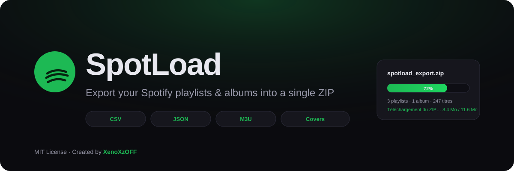

<p align="center">
  
</p>

<h1 align="center">SpotLoad</h1>

<p align="center">
  <strong>Export your Spotify playlists, albums &amp; tracks into a single ZIP file</strong><br/>
  Metadata · Covers · CSV · JSON · M3U
</p>

<p align="center">
  <a href="README.md"></a>
  <a href="README.fr.md"></a>
</p>

<p align="center">
  <a href="LICENSE"></a>
  = 18"/>
  
  
</p>

---

## What is SpotLoad?

SpotLoad is a free, open-source, self-hosted web app that lets you export any Spotify content — **playlists, albums, artists, liked songs, or individual tracks** — into a single ZIP file packed with rich metadata and artwork.

Paste a link, search a song, or connect your Spotify account to browse your full library. Select what you want, pick your export options, and download.

> **SpotLoad does not download audio.** Spotify streams are DRM-protected and the official API provides no audio download capability. SpotLoad exports metadata, track info, and album covers only — perfect for archiving, spreadsheets, or importing into music managers.

---

## Features

| | |
|---|---|
| **Any Spotify link** | Paste playlist, album, artist, or track URLs (web links or `spotify:` URIs) |
| **Full library access** | Connect with Spotify to see private playlists, saved albums & liked songs |
| **Song search** | Search any track on Spotify and add it with one click |
| **Manual selection** | Mix and match individual songs from search into a custom selection |
| **Multi-collection ZIP** | Combine several playlists, albums & tracks into one export |
| **Rich exports** | CSV, JSON, M3U playlist, album covers — toggle each on/off |
| **Detail view** | Paginated track list — display 10 / 20 / 30 / 40 / 50 / 100 / up to 250 tracks |
| **Granular control** | Select/deselect individual tracks, whole collections, or everything at once |
| **Live progress** | Real-time download progress bar with percentage |
| **Responsive UI** | Smooth dark interface with the Unbounded typeface, works on mobile |
| **Loading screen** | Animated splash screen on startup |
| **Privacy first** | Self-hosted — your credentials & sessions never leave your machine |

---

## Preview

| | | |
|:---:|:---:|:---:|
| Paste links & search songs | Browse your full library | Paginated track detail |
| Animated splash screen | Live ZIP progress with % | Mobile responsive |

---

## Quick Start

### Prerequisites

- **Node.js** ≥ 18
- A **Spotify account** (Free or Premium)
- A free **Spotify Developer app** (2 minutes to set up)

### Installation

```bash
git clone https://github.com/XenoXzOFF/spotload.git
cd spotload
npm install
cp .env.example .env
```

### Configuration

Open `.env` and add your Spotify credentials:

```env
SPOTIFY_CLIENT_ID=your_client_id
SPOTIFY_CLIENT_SECRET=your_client_secret
PORT=3000
MARKET=FR
```

### Launch

```bash
npm start
```

Open **http://localhost:3000** and start exporting.

---

## Spotify App Setup

You need a free Spotify Developer app to use SpotLoad. Here's how to create one:

1. Go to the [Spotify Developer Dashboard](https://developer.spotify.com/dashboard)
2. Click **Create app**
3. Enter any name and description (e.g. "SpotLoad")
4. Add this **Redirect URI** — exactly as shown:
   ```
   http://127.0.0.1:3000/callback
   ```
   > **Note:** Spotify rejects `localhost` since 2025. Use `127.0.0.1` instead.
5. Under **Product completion**, enable **Web API**
6. Click **Save**
7. Copy the **Client ID** and **Client Secret** into your `.env` file
8. Restart the server

---

## How to Use

1. **Paste a link** — playlist, album, artist, or track URL → click **Add** (or press Enter)
2. **Search songs** — type a song or artist name → click **Search** → click **+** on any result
3. **Connect with Spotify** (top right) to unlock your private playlists, saved albums & liked tracks
4. **Click any collection** to open the detailed track view — choose display count (10–250), tick tracks
5. **Select or deselect** tracks individually, per collection, or globally
6. **Toggle ZIP options** — CSV / JSON / M3U / Covers
7. **Click Download ZIP** — watch the live progress bar

---

## ZIP Contents

```
spotload_export_2026-01-01.zip
├── 01 - Playlist - My Playlist/
│   ├── tracks.json          Full track data + collection metadata
│   ├── tracks.csv           Spreadsheet-ready (UTF-8 BOM)
│   ├── tracks.m3u           M3U playlist with durations & links
│   ├── cover.jpg            Collection artwork
│   └── covers/              Per-track album art (optional)
│       ├── 01 - Artist - Song.jpg
│       └── …
├── 02 - Album - Some Album/
│   └── …
├── 00_tous_les_titres.csv   Flat list of every selected track
└── 00_tous_les_titres.json
```

### CSV columns

`#`, `Titre`, `Artistes`, `Album`, `Date de sortie`, `Durée (ms)`, `ISRC`, `Popularité`, `URL Spotify`, `URL preview`, `URL pochette`

---

## API Endpoints

| Method | Route | Description |
|---|---|---|
| `GET` | `/api/health` | Server configuration status |
| `GET` | `/auth/login` | Start Spotify OAuth flow |
| `GET` | `/callback` | OAuth redirect handler |
| `POST` | `/auth/logout` | Destroy session |
| `GET` | `/api/me` | Current Spotify user |
| `GET` | `/api/library` | User playlists, saved albums, liked count |
| `GET` | `/api/search?q=` | Search tracks |
| `POST` | `/api/collections` | Resolve URLs into full collections |
| `POST` | `/api/library-collection` | Fetch liked-songs collection |
| `POST` | `/api/zip` | Build & stream ZIP download |

---

## Project Structure

```
spotload/
├── server.js              Express server & API routes
├── src/
│   ├── auth.js            OAuth (Authorization Code), sessions, token refresh
│   ├── spotify.js         Spotify Web API client
│   ├── zip.js             ZIP builder — CSV, JSON, M3U, covers
│   └── util.js            URL parsing, filename sanitizing, CSV helpers
├── public/
│   ├── index.html         Frontend shell (splash screen included)
│   ├── app.js             UI logic (minified)
│   └── style.css          Styles & animations (minified)
├── assets/
│   └── banner.svg         Repository banner
├── .env.example           Environment template
├── LICENSE                MIT License
├── README.md              English documentation
├── README.fr.md           French documentation
└── package.json
```

---

## Tech Stack

| Layer | Technology |
|---|---|
| Runtime | Node.js ≥ 18 |
| Server | Express, cookie-parser, dotenv |
| ZIP | archiver |
| Frontend | Vanilla JS, CSS animations |
| Typography | [Unbounded](https://fonts.google.com/specimen/Unbounded) (Google Fonts) |
| API | [Spotify Web API](https://developer.spotify.com/documentation/web-api) (OAuth 2.0) |

---

## FAQ

**Why doesn't SpotLoad download audio?**
Spotify streams are protected by DRM. The official Web API does not expose any audio download endpoints. SpotLoad exports metadata, links, and artwork only.

**Do I need Spotify Premium?**
No. SpotLoad works with Free and Premium accounts.

**Is my data safe?**
Yes. SpotLoad is fully self-hosted. Your Spotify credentials stay in your `.env` file, and sessions live in server memory only.

**Can I export private playlists?**
Yes, after connecting with Spotify. Private playlists appear in your library browser.

---

## Contributing

Contributions are welcome!

1. Fork the repository
2. Create a feature branch: `git checkout -b feature/my-feature`
3. Commit your changes: `git commit -m "Add my feature"`
4. Push and open a Pull Request

---

## License

Distributed under the **MIT License**. See [`LICENSE`](LICENSE) for details.

---

## Credits

<p align="center">
  Created with ❤️ by <strong><a href="https://github.com/XenoXzOFF">XenoXzOFF</a></strong>
</p>

<p align="center">
  <a href="https://github.com/XenoXzOFF">
    
  </a>
</p>
